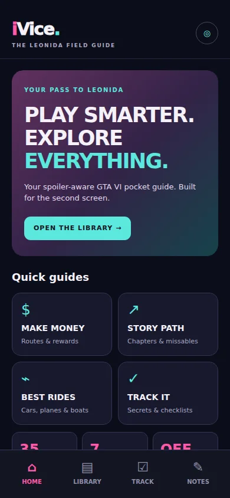
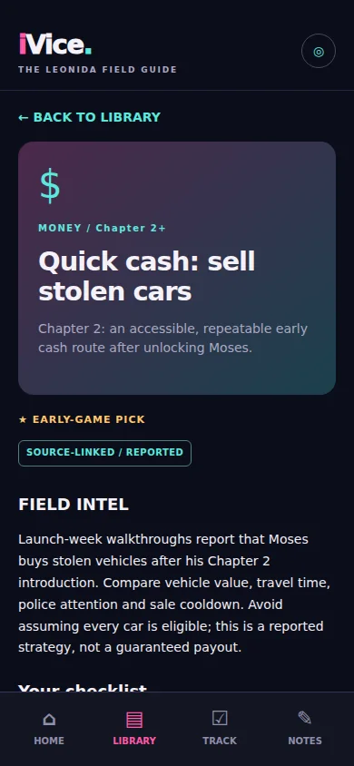

# iVice

**An offline-first GTA VI pocket guide built to sit beside your controller.** Native Expo / React Native / TypeScript for iOS and Android, inspired by the *utility* of Gunther's Library but with an original neon, midnight-purple visual language.

> **Project status:** functional source-code MVP, not an App Store release. The iVice preview and coming-soon website are independently deployable GitHub Pages files. The native app has not yet been validated on physical devices.

[Coming-soon website](https://azayzel.github.io/iVice/) · [Interactive mobile UI preview](https://azayzel.github.io/iVice/preview.html) · [Guide hub](https://azayzel.github.io/iVice/wiki.html) · [PLAN](PLAN.md) · [Decisions](DECISIONS.md) · [Security](SECURITY.md)

## Screen gallery

These are **historical screenshots captured by Playwright in GitHub Actions** from the interactive iVice *browser preview*. They are not iOS Simulator or Android device screenshots; those still need a native release build. The original SVG design studies are also preserved in `docs/screenshots/`.

| Home & quick guides | Money recommendations | Source-linked guide |
|---|---|---|
|  |  |  |

[See the full-size coming-soon page screenshot](docs/screenshots/landing-desktop.webp) · [Passing browser screenshot workflow](https://github.com/Azayzel/iVice/actions/runs/45679198900)

## What the guide does

- **Make money:** source-linked route references with reported unlock stages, prerequisites and risks.
- **Story:** chapter roadmaps separate transition triggers and required milestones from optional tasks. Mission names require a separate reveal; the app does not read your save or estimate remaining time.
- **Best vehicles:** comparisons for cars and getaways, airplanes/helicopters, speedboats and off-road vehicles. Rankings distinguish demonstrated in-game facts from launch-week reporting; no fabricated top speeds.
- **Wikipedia-style library:** character and region references with links to original sources (including Brian Heder on Rockstar and Fandom), search, categories and bookmarks.
- **Discoveries:** source-linked references and per-playthrough bookmarks; no sign-in or internet connection is needed to read bundled material.
- **ViceFiles integration:** opt-in manual sync of *moderator-approved* guide entries via a read-only API contract. It never posts user notes to the server.

### What counts as a recommendation?

`official` denotes a summary based on Rockstar's public material. `community`/`reported` means iVice links to independently published walkthroughs or launch-week research, but has *not* personally measured the result. `template` is a user checklist, **not a game fact**. All articles have original descriptions and link to third-party material rather than copying it. Content status can be corrected as better evidence arrives.

### Current native experience

Home uses a phone-inspired launcher: one chapter widget, color-coded circular category icons, search, and compact reference lists. Chapter and region controls are available from the region selector; Story also exposes chapter selection. Reading screens use divider-based rows and bundled Outfit typography, with a system-font fallback while fonts load or if loading fails. Existing theme selections, bookmarks, spoiler controls, and per-playthrough data are preserved.

Navigation is **Home, Library, Story, Settings**. Notes, Track, guide checkboxes and completion bars have been removed. Template entries are hidden. Existing SQLite notes and progress are retained for compatibility, but are no longer loaded into the interface or used to suppress recommendations. Earlier screenshots and feature history below describe the previous UI; the standalone browser demo has not been updated to match.

Native navigation uses short fade/slide transitions and spring press feedback through React Native Animated, without a web motion dependency. The system Reduce Motion setting disables these effects and the guide modal's slide. The tab bar owns the bottom safe-area background while keeping buttons above the home indicator. Physical-device checks should include rapid tab switches, press cancellation while scrolling, and toggling Reduce Motion while the app is open.

Chapter roadmaps in [src/chapters.ts](src/chapters.ts) summarize PowerPyx's mission index and individual transition walkthroughs, reviewed November 25, 2026. These are reported findings, not official Rockstar rules or independently play-tested results. Optional examples are not an exhaustive missables guide. Chapter 5 is treated as the final chapter, not as a transition to a fabricated Chapter 6.

Library now separates an **Encyclopedia** of named subjects from general **Guides**, with an **All** search. Names and aliases rank ahead of body-text matches. People, locations, vehicles and weapons can be opened from Home or filtered in Library. Subject pages show images, known details, location/acquisition gaps, sources and related entries with back navigation. Search results, counts and related links respect the existing chapter and spoiler rules. No stats, prices, spawn conditions or unlock requirements are inferred from images.

### Screenshot library

The user-supplied originals remain unchanged under [data/GTAVI_Screenshots](data/GTAVI_Screenshots). [data/library-media.json](data/library-media.json) explicitly maps 137 photos to 20 subjects: eight people, six locations, five vehicles and one weapon entry. The other 64 images remain unassigned rather than being attached to an unrelated subject. The image-only entries use names from the supplied filenames and are labeled as image references, not independently verified game data. Existing sourced profiles retain their original provenance; their images are labeled separately.

Run `npm run media` after adding or changing a mapping. It builds metadata-stripped JPEGs (maximum 1440px), small thumbnails and [src/library-media.generated.ts](src/library-media.generated.ts) with static Metro asset references. Only these optimized files are imported by the app, not the 4K originals. The current mapped set is about 18.8 MB including thumbnails. `npm run media:check`, also included in `npm run check`, validates the mappings, generated registry and image bounds; it requires the original screenshot directory.

Galleries offer previous/next controls and a full-screen viewer with iOS pinch zoom. Additional photos require a separate warning confirmation while global spoilers are hidden, since they have not been individually reviewed for story spoilers. Gallery interaction, full-screen zoom and nested modal dismissal still require physical-device testing.

These supplied images are integrated for local development. Their addition does not establish permission for public redistribution. Verify image rights before publishing the app or screenshot assets.

### Brand assets

The supplied SVG originals live in `src/ivice-*.svg`. Run `npm run icons` after editing them to regenerate the mobile icon (1024px), header logo (128px) and favicon (32px). The maskable SVG is preserved for a future web manifest. Expo uses the mobile PNG for native builds; Expo Go keeps its own installed home-screen icon. The header logo updates during development without a native rebuild.

## Quick start

Requirements: Node 22.13+, npm, iOS simulator on macOS or Android emulator/compatible Expo Go (Expo SDK 58).

```bash
npm install
npm run test
npm run typecheck
npm start
```

The app opens locally with a bundled catalog and an on-device SQLite database. Check `npx expo install --check` if dependency ranges change. No server or account is required for its base functionality.

### Development website preview

The docs folder is a standalone static site; you can open `docs/index.html` or serve the directory:

```bash
python -m http.server 8080 --directory docs
# http://localhost:8080
```

`docs/preview.html` is a small **interactive browser demo** featuring the same guide categories, clickable article details, source links and checklist behavior. It uses browser localStorage for sample checkboxes rather than the native app's SQLite implementation. The browser demo and the Expo app are distinct front ends using the same curated content model.

## Tests & screenshots

```bash
npm run test                 # Content schema, provenance, category and ID checks
npm run typecheck            # TypeScript (requires npm install)
python -m pip install playwright pillow
python -m playwright install chromium
python scripts/visual_snapshots.py       # Visual UI smoke checks + real browser screenshots
python scripts/visual_snapshots.py --verify  # Compare against previously generated baselines
```

The last command writes four PNG snapshots (mobile home, mobile money catalog, mobile money guide, desktop landing) to `docs/screenshots/`. `--verify` compares the pixels against those files, allowing a small cross-platform antialiasing tolerance. On CI, the workflow uploads **browser-snapshot-artifacts** for each run; see GitHub Actions. To update a browser baseline intentionally, run the script without `--verify` and review the image diff before committing.

The local browser in the authoring environment has administrator navigation blocking, so those browser capture checks could not be run here. **Do not confuse the SVG previews above with screenshots captured from the running Expo app.**

## GitHub Pages and guide hub

`docs/index.html` is the responsive prelaunch landing page, `docs/preview.html` is the interactive app preview, and `docs/wiki.html` is the coming-soon guide hub. A Pages deployment workflow is provided in `.github/workflows/pages.yml`.

**One-time repository setting:** Go to **Settings → Pages → Build and deployment → Source: GitHub Actions** (if not already selected). The workflow deploys `docs/` on pushes to `main`. Until Pages is enabled and the deployment succeeds, the links above may not resolve.

GitHub's separately hosted repository **Wiki** is not the same as GitHub Pages. This starter supplies a branded coming-soon *guide hub* at `/wiki.html`; editing the actual `Azayzel/iVice/wiki` Git repository is a separate step and has not been performed.

## Optional guide sync

Set `EXPO_PUBLIC_API_URL=https://your-api.example` in a local `.env`; no keys are required. In Settings, tap **Sync curated guides**. The app requests `GET /api/guides` and validates the payload before replacing a remote-only snapshot. This is a **client contract only**; the ViceFiles backend needs the matching read-only endpoint. Only moderator-approved content should be published; don't turn unreviewed Reddit scrape results into verified recommendations.

Expected payload:

```json
{"entries":[{"id":"vf-guide-example","title":"Example","category":"Money","summary":"Original curated summary","body":"Original explanation and evidence","region":"Vice City","sourceType":"community","sourceUrl":"https://example.com/evidence","sourceLabel":"Evidence","spoiler":false,"tags":["money"],"steps":[{"id":"review","label":"Review the evidence"}],"sources":[{"label":"Evidence","url":"https://example.com/evidence"}],"confidence":"reported","stage":"Chapter 2+"}]}
```

## Editorial and licensing

iVice is an **unofficial fan-made companion**, not affiliated with Rockstar Games, Take-Two, or Fandom. No copyrighted artwork, map screenshots, gameplay videos, or Fandom article text are bundled. Before publishing on app stores, assess trademark, third-party content licenses, terms for use, privacy policy and moderation obligations.

This is an open-source starter; choose a LICENSE before accepting outside contributions. See [TODO](TODO.md) for the planned map, cloud sync, verified player-submitted guides, native snapshots and platform QA.
### Native flow hardening

Saved guides now have a dedicated Library filter and home shortcut. Search matches multiple terms across the guide body, title, tags, region and vehicle class. Profile changes, note mutations, checklist updates and sync are serialized to prevent cross-playthrough writes; unfinished note drafts are retained separately in memory for each playthrough while the app stays open. Preview screenshots depict the separate HTML prototype; they are not native runtime validation. Content recommendations are source-linked launch reports, not play-tested rankings.

The home screen offers one-tap search, results load in batches of 30, and spoiler protection warns before opening third-party guide sources. The `scripts/persistence.test.mjs` suite executes the actual persistence SQL against Node's SQLite engine and checks remote payload validation. It does not replace Expo device tests.

## Play session dashboard

Choose a chapter (or leave it unset) and optionally an in-game region. Each playthrough independently remembers chapter, region, last opened guide and checklist state in SQLite. The home screen recommends eligible, unfinished money and story guides, optional activities, vehicle research picks and matching regional references. Unconfirmed vehicle unlocks are explicitly marked; region matches are not GPS or collectible coordinates. No account or location permissions required.

**Spoilers:** default off. Known later-chapter entries and explicitly spoiler-tagged entries are hidden. The home and Library controls reveal all guides if desired; this never upgrades future entries into current-chapter recommendations. External references may reveal plot details. Editorial classification is required for every new guide.

**Appearance:** Jason (muted charcoal/green), Lucia (plum), Classic Vice (neon). Original utility-style palettes, compact launcher and guide cards, not copied in-game assets.

The interactive browser preview now demonstrates chapter/region selection, spoiler override, saved guides and the three themes. The gallery above is archival; new Playwright screenshots are available in the latest CI run artifacts. Browser preview tests are not native device evidence.
## Reddit community research (2026-11-25)

The bundled catalog now contains 53 entries, including 17 original Reddit-derived guides with direct links. Search for `reddit` in the Library. These are reported findings, not independently tested facts. Spoiler-sensitive discoveries are opt-in. See [COMMUNITY_RESEARCH.md](COMMUNITY_RESEARCH.md) for sources and validation limits.
